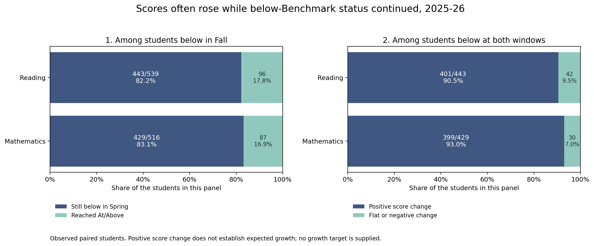

# Elementary School Progress & Attendance

[← Back to my analytics portfolio](https://github.com/ksitcode00/portfolio-project)

- **Context:** Education analytics performance task using synthetic student information system data
- **Tools:** Python, pandas, statsmodels, Jupyter, JavaScript and PowerPoint
- **Scope:** Four K–5 schools across the 2023–24 to 2025–26 academic years
- **Author:** Ka Wai Sit · 2026

## Executive Summary

A new director responsible for four elementary schools needs to know whom the schools serve, how students progressed and what to ask principals first. I checked nine source tables across the synthetic district, built consistent student and test samples, and prepared a ten-slide briefing around learning progress and continuing needs.

In 2025–26, **82.2% in reading and 83.1% in math** of students who started below Benchmark and had paired tests remained below in spring. Among the students below at both tests, **90.5% in reading and 93.0% in math** gained score points. I used these two measures to show progress alongside the need for continued support.

**[Analysis notebook](notebooks/fairmont_school_analysis.ipynb)** · **[PowerPoint briefing](briefing/KaWaiSit_Level_Director_Briefing.pptx)** · **[Methodology](docs/methodology.md)** · **[Data availability](data/README.md)**



## Key Findings

| Evidence | What it means for the briefing |
| --- | --- |
| **618 of 1,401** enrolled students were observed below Benchmark in fall and spring in at least one subject. **254** showed the pattern in both subjects. The total includes **76** students with a known pattern in one subject and incomplete information in the other. | Review learning needs across both subjects and keep incomplete testing paths visible. |
| In exploratory models pooled across three years, the adjusted probability of remaining below in spring was about **97%** for students who began Well Below and **71%** for those who began Below. The gap was about **26 percentage points** in each subject. | Ask how principals monitor and adapt support for students who start furthest below. |
| Five percentage points more absence between tests was associated with about **0.20 fewer reading score points** and **0.32 fewer math score points** after adjustment. The raw association was about **2.7 fewer points** in both subjects. | Discuss attendance barriers and learning support together. The adjusted associations were small and describe historical patterns. |
| Of the **618** identified students, **143** had at least 10% annual absence and **475** were below that threshold. The two groups use annual enrolled days. | Coordinate support for overlapping needs and retain an academic follow-up route for students with lower absence. |

Adjusted school contrasts were small and uncertain, with intervals spanning zero. The briefing uses these results to frame principal conversations and verify current enrollment and services. The models do not estimate school effectiveness or intervention impact.

## Analysis Walkthrough

1. **Validate and join.** Check keys, dates, relationships, coverage and business rules across enrollment, attendance, assessment, calendar and other SIS tables. Summarize daily attendance before joining to one row per student and school year.
2. **Define comparable samples.** Use all enrolled students for school profiles, spring-tested students for spring status and paired fall/spring tests for growth. Calculate absence from actual enrolled instructional days and use the distinct between-test window in the score models.
3. **Estimate adjusted associations.** Fit subject-specific OLS models with fall score, school, grade and year, then add between-test absence on the same samples. Cluster uncertainty by student and review diagnostics and sensitivity fits. Use exploratory logistic models to compare continued below-Benchmark status across fall starting groups.
4. **Translate evidence into questions.** Verify historically identified students against current rosters, review support for the lowest starting group, and coordinate academic and attendance support where needs overlap.

## Project Files

| Resource | Purpose |
| --- | --- |
| [Jupyter notebook](notebooks/fairmont_school_analysis.ipynb) | QC, EDA, model specifications, diagnostics, sensitivity checks and interpretation. Published with cell outputs cleared. |
| [Briefing](briefing/KaWaiSit_Level_Director_Briefing.pptx) | Ten presentation slides with editable charts and speaker notes. |
| [Learning results](learning_results/) and [model results](model_results/) | Aggregate tables and figures from the completed analysis. |
| [Dashboard source](dashboard/README.md) | Local HTML export and chart code, with fixture checks for aggregation and filtering. |
| [Methodology](docs/methodology.md) and [AI disclosure](docs/ai_disclosure.md) | Analytical definitions, interpretation and my role. |

## Reproduce the Analysis

Use Python 3.11 or newer. With access to the nine original synthetic CSVs, place them in `data/source/` and run the notebook from the repository root or `notebooks/`. The [data note](data/README.md) lists the expected files. Aggregate outputs and the briefing are ready to review on GitHub.

```bash
python -m venv .venv
source .venv/bin/activate
python -m pip install -r requirements.txt pytest
python -m jupyterlab
```

The Python and JavaScript checks can run without the supplied source files. The JavaScript checks use Node.js 22 or newer.

```bash
python -m pytest tests dashboard/test_export.py dashboard/test_model_export.py
node dashboard/test_dashboard.mjs
node dashboard/test_learning_needs.mjs
```

## My Role

I set the project direction, refined the questions and analytical choices, and decided which findings and follow-up actions to present. I take responsibility for reviewing the calculations and interpretation. OpenAI Codex assisted with code and troubleshooting, the local dashboard, question organization, editing and slide preparation. See the [full disclosure](docs/ai_disclosure.md).
